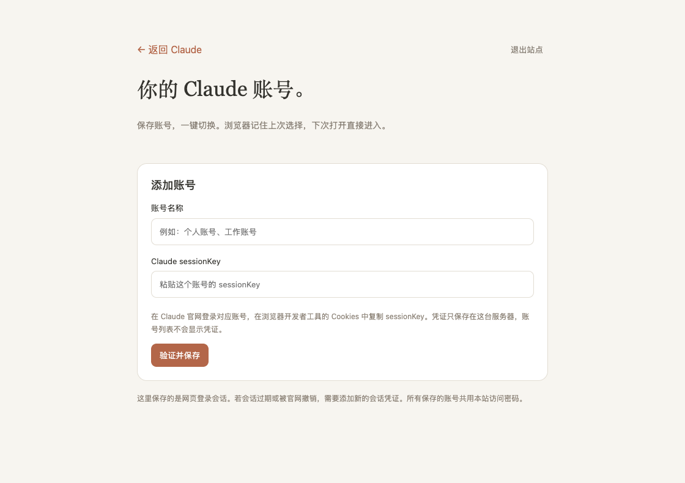

# MyMirror

MyMirror 是一套自托管的 Claude 镜像，从此前使用的 9443 版整理而来。它保留账号侧栏，并把流式回复、附件传输和 Claude Docs 预览的兼容处理带到新部署。镜像使用已有的 Fuclaude 运行程序；本仓库与 Anthropic 无隶属关系。

## 从旧版带过来的功能

- **流式回复：** HTTPS 主站支持 HTTP/2；转发层不等待整段回复结束，保留 SSE、Connect 响应和相关请求头。
- **附件与下载：** 保留附件请求的原始二进制内容和重复查询参数。文件响应逐块下发，支持 Range；遇到缺失的 Content-Type，按响应中的文件名推断类型。桥接层仍会先读完整的上传请求体，上传上限为 100 MiB。
- **Docs 预览：** 使用独立的浏览器来源和预览端口，保留文件视图渲染、授权 Cookie 隔离及 WebSocket 同步。
- **思考展示：** 响应中上游已提供给页面的公开思考事件会随流转发；具体展示取决于模型和上游界面。旧版曾试用的自定义实时思考面板已回退。

## 用私有包迁移到新机器

已经持有两份原版运行文件的用户，可以从 Git 工作目录生成私有部署包。包内含当前提交的源码和两份运行文件；新实例会创建自己的站点配置和空账号库。

~~~sh
python3 deploy/package.py ../MyMirror-deploy-private.tar.gz
~~~

把包通过受控渠道传到 Linux x86-64 机器，解压到空目录后启动：

~~~sh
tar -xzf MyMirror-deploy-private.tar.gz
cd MyMirror
make up
~~~

私有包包含外部运行资源，请和公开源码分开存放。目标机器仍需安装本节下方列出的工具。

## 先启动一个本机实例

需要 Linux x86-64、Docker Compose、Python 3.9 或更新版本、OpenSSL 和 make。请先准备这两份你有权使用的运行文件：

| 放置路径 | 所需文件 |
| --- | --- |
| `private/fuclaude` | 与 [manifest.json](manifest.json) 中记录一致的 Linux x86-64 程序，参考 [Fuclaude v0.5.1 发行页](https://github.com/wozulong/fuclaude/releases/tag/v0.5.1)。 |
| `private/frame-shell.js` | 原有部署使用的文件预览脚本，版本也须与清单一致。 |

GitHub 提供的是自定义源码与部署配置。克隆后，放好这两份文件才能启动。

~~~sh
git clone https://github.com/fangming3562/MyMirror.git
cd MyMirror
mkdir -p private
# 把上面两份文件放入 private/
make up
~~~

启动器会校验文件并生成一个空账号库。打开 [https://127.0.0.1:9443/mirror/accounts](https://127.0.0.1:9443/mirror/accounts)，用本机 `runtime/site-password` 里的站点密码进入账号管理。首次启动生成自签证书；默认只监听本机回环地址。

在没有 Docker 的 Linux 主机上，可以用带 HTTP/2 模块的标准 Nginx 和独立 Python 环境运行：

~~~sh
python3 -m venv .venv
.venv/bin/python -m pip install -r requirements.txt
.venv/bin/python deploy/setup.py
.venv/bin/python deploy/run.py --nginx /usr/sbin/nginx
~~~

## 接入其他设备

默认主站用 HTTPS `9443`，文件预览使用独立来源和 `11443–11474` 端口。仅远程检查登录和账号页时，可以通过 SSH 转发主站端口。对外部署时，给主站和预览配置独立域名与相应的有效证书，只开放所需端口。参数和验收步骤见[部署说明](deployment-target.md)。

此版本适合个人或可信环境：知道站点密码的人共享该实例的账号列表。网页登录会话保存在服务器的 `runtime/accounts.json` 中，文件限制访问权限，但内容未加密。请把 `runtime/` 与源码分开备份；`make down` 停止服务时会保留这些数据。自行构建的 Docker 镜像包含两份外部运行文件，发布源码时不要一并上传镜像。

## 验证

~~~sh
make test PYTHON=.venv/bin/python
~~~

已用独立的 Linux 实例验证原生启动、HTTPS、站点登录和空账号管理页。自动测试覆盖账号切换、预览路由、首个流式事件、附件请求内容及分段下载。Docker 构建，以及真实账号的流式回复、上传和下载，部署时仍需按[验收列表](deployment-target.md#验收列表)核对。
